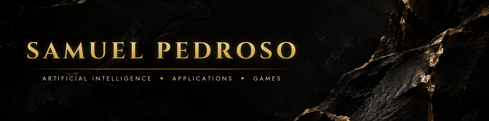

  

  

◆&nbsp;&nbsp;INDEPENDENT AI AND SOFTWARE ARCHITECT&nbsp;&nbsp;◆&nbsp;&nbsp;ITATIBA, BRAZIL&nbsp;&nbsp;◆

 

## ◆ The Philosophy

I do not follow trends. I build the systems behind them.

My work lives where artificial intelligence meets products people use every day. I take an idea from nothing to something real, and I own every layer along the way, from the model to the interface. Every system I create has one purpose, to remove effort and multiply leverage.

**Work so you don't have to work.**

 

## ◆ Currently Building

<table>
<tr>
<td width="33%" valign="top">

### 🧠 Artificial Intelligence

**Biocomputing**
Neural networks that predict how proteins interact, built to accelerate the discovery of more effective drugs. Human benchmark complete. Now training on strict protein level splits and preparing an open source release.

**Quant AI**
Neural networks competing in a global financial prediction tournament, trained and deployed for real use.

**Trackmania AI**
A reinforcement learning agent trained to chase the fastest lap possible.

</td>
<td width="33%" valign="top">

### 📱 Applications and Systems

**Anoniko**
Anonymous communication with no login. Contacts are added by QR code, so identity never has to be exposed.

**A New Programming Language**
Low level, AI native and tuned at the bit level for games and machine learning. Engineered for raw performance.

**Pulsar**
An LLM and RAG assistant running in production on a factory floor, answering quality and process questions in real time.

</td>
<td width="33%" valign="top">

### 🎮 Games

**Genshin Project**
A Minecraft Bedrock world rebuilt with anime inspired terrain and landmark structures, aimed at the official Marketplace.

**Slink.io**
A fast browser arcade game headed for CrazyGames and Poki.

**Roblox Competitive Clicker**
Short ranked rounds, pets and boosts, designed around the player economy.

</td>
</tr>
</table>

 

## ◆ Arsenal

ARTIFICIAL INTELLIGENCE
 

 

SYSTEMS AND APPLICATIONS
 

 

GAME DEVELOPMENT
 

 

## ◆ Track Record

Pulsar runs in production on a real factory floor. I have trained models from scratch on cloud GPUs, shipped Telegram based financial assistants, taught others to build with AI, and I am now writing my first book.

 

## ◆ Performance

 

 

 

## ◆ Get In Touch

For partnerships, serious projects and ambitious ideas.

  

